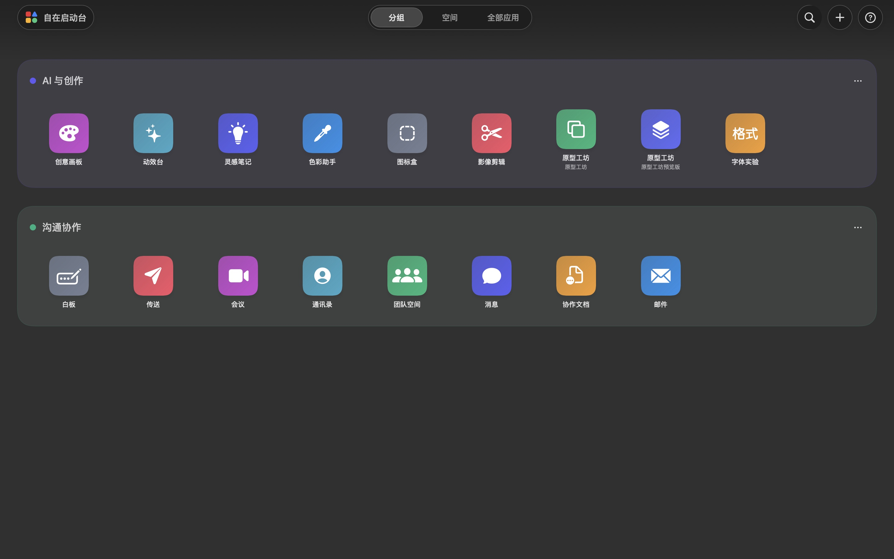
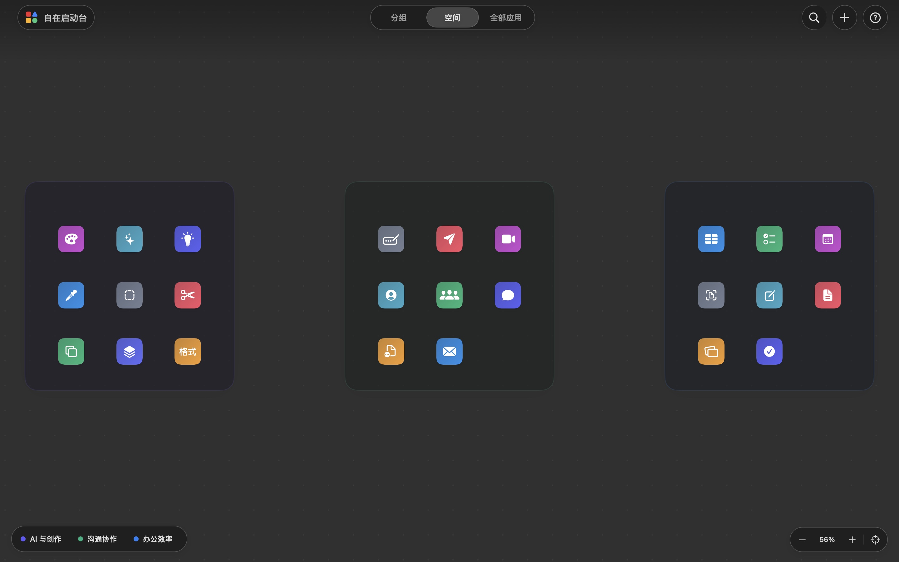

# 自在启动台

简体中文 · [English](README_EN.md)

一个本地优先、可自由组织的 macOS 应用启动器。

自在启动台不是系统 Launchpad 的替换层，也不修改、卸载或上传你的应用。它只在普通 macOS 窗口中扫描已安装应用，并让用户用分组、自由空间、别名和搜索建立自己的启动视图。






## 为什么需要它

Dock 适合少量高频应用，Spotlight 适合已经记得名称的直接搜索。当应用数量增多、存在多个安装实例，或需要按工作情境建立稳定空间记忆时，线性列表不再足够。

自在启动台不企图取代系统搜索：它提供可见的分组、稳定的空间位置、本地别名和多实例识别，用于“看见并组织”，而 Spotlight/Raycast/Alfred 等工具更擅长“输入并执行”。两者可以并存。

## 产品原则

- **不打扰**：登录时后台准备默认关闭；开启后也不弹窗、不抢焦点、不占用程序坞。
- **不破坏**：隐藏、分组、改名和删除分组只影响启动台自己的布局。
- **不上传**：应用不联网，不包含追踪 SDK，布局保存在 App Sandbox 容器中。
- **即时响应**：扫描、图标准备和布局保存不阻塞主线程；Tab 页面在首次预热后持久复用。
- **行为可验证**：标准 XCTest 覆盖核心回归，独立 XCUITest 方案覆盖关键用户路径，审计程序覆盖拖放、碰撞、迁移、撤销、性能和视觉边界。

## 核心功能

- 分组视图：分组与应用都可拖动换序，支持跨组移动、改名和识别色。
- 空间视图：自由移动、缩放分组，应用落点自动保持在安全区且不重叠。
- 全部应用：统一管理显示与隐藏，不改变原应用。
- 即时搜索：名称、用途和分组优先精确命中，可见名称支持字母顺序容错；应用包名和路径只做连续片段匹配，避免技术字段带来噪声。
- 多实例识别：同 Bundle ID 的多个安装副本会按真实路径独立显示和保存。
- 中文别名：可为任意应用设置本地显示名，不修改应用包。
- 安全撤销：移动、换组、隐藏、改名和删除分组均可撤销。
- 损坏恢复：主布局解析失败时从已验证的备份恢复。

## 技术特点

- Swift 6、SwiftUI + AppKit，单一 macOS App Target、标准 XCTest Target 与独立 XCUITest Target。
- Universal 2（arm64 + x86_64），Deployment Target 为 macOS 13。
- macOS 26 上使用原生 Liquid Glass 视觉，旧系统使用统一兼容层。
- App Sandbox、用户选择的只读安全范围书签、`SMAppService.mainApp`。
- 可取消的后台扫描、分批图标预热、串行非主线程持久化。
- 原子 JSON 写入、已验证备份、schema 迁移和不完整扫描保护。
- 单一 `LauncherStore` 状态聚合根配合目录、应用放置、分组和画布四个命令边界；所有可撤销操作通过值语义状态修订原子提交，不依赖视图闭包。
- Release 开启严格并发检查、warning-as-error、App Sandbox 和 Hardened Runtime。

详细设计见 [ARCHITECTURE.md](ARCHITECTURE.md)。

## 环境要求

- macOS 13 或更高版本。
- 完整 Xcode；当前工程在 Xcode 27 验证。
- 无第三方依赖。

## 构建

```sh
./scripts/build.sh
```

产物位于 `.artifacts.noindex/自在启动台.app`，同时生成 UUID 匹配的 `.artifacts.noindex/自在启动台.app.dSYM`。该隐藏目录不参与 Spotlight 索引，避免开发产物被 macOS 识别为第二个正式应用。该产物使用本地临时签名，用于开发回归，不是 App Store 或 Developer ID 发布包。

## 验证

先运行 Xcode 原生单元测试：

```sh
xcodebuild test \
  -project "自在启动台.xcodeproj" \
  -scheme "自在启动台" \
  -destination "platform=macOS,arch=$(uname -m)"
```

运行完整本地发布门槛：

```sh
./scripts/verify_release.sh
```

该命令会重新构建、串行运行完整 XCTest 回归套件、执行关键模块覆盖率硬门槛、真实运行完整独立 XCUITest 套件，并检查：

- 交互几何、搜索、多实例扫描、数据迁移、撤销和备份恢复。
- Tab 切换、首帧准备、主线程响应和画布拖动性能。
- 登录项默认状态、静默启动、应用文件夹授权恢复。
- Universal 2、macOS 13 部署目标、深浅色、降低动态效果、降低透明度和紧凑窗口。
- 架构职责、依赖方向和文件复杂度上限，以及已安装布局的分组/应用几何不变量；这些静态与数据审计不替代运行行为证据。

当前验证环境、实测指标和证据边界见 [QUALITY_REPORT.md](QUALITY_REPORT.md)。

如需单独重跑界面门槛，可真实执行端到端用户路径：主导航与帮助弹窗、搜索多实例与两种外点收起、真实指针拖动分组换序、真实指针跨组移动应用、空间内拖动应用及相应撤销、菜单跨组移动、应用显隐、画布缩放，以及新建分组外点收起与重启持久化。独立交互审计继续覆盖拖放边界几何、状态事务和性能，两层证据必须同时通过。

```sh
./scripts/run_ui_tests.sh
```

`verify_release.sh` 与 CI 的统一 Release 门槛都会调用该脚本；编译成功不能替代运行通过。当前发布结论及仍需账号或硬件完成的证据见 [RELEASE_READINESS.md](RELEASE_READINESS.md)。

代码风格检查：

```sh
xcrun swift-format lint --strict --recursive Sources Tests
```

## 项目结构

```text
Sources/       产品源码
Tests/XCTest/  Xcode 原生单元测试
Tests/XCUITests/ 独立端到端界面测试
Tests/         独立行为、兼容性、渲染与性能审计
Resources/     Info.plist、沙盒权限、隐私清单与图标源
scripts/       构建、验证、安装与发布门槛
handoff/       图标来源、兼容性调查与当前验证入口（当前视觉证据统一位于 AppStore/Screenshots）
```

## 隐私与权限

- 默认只扫描 macOS 系统应用目录。
- 额外应用文件夹只在用户主动选择后读取，授权可随时移除。
- 不请求辅助功能、输入监控、照片、通讯录或位置权限。
- 不含分析、广告或第三方追踪代码。

隐私清单见 `Resources/PrivacyInfo.xcprivacy`，用户说明见 [PRIVACY_POLICY_ZH.md](PRIVACY_POLICY_ZH.md)。

## 贡献

请先阅读 [CONTRIBUTING.md](CONTRIBUTING.md)。贡献需要保持现有隐私边界、数据迁移和发布门槛，不能用“重写后能跑”代替行为兼容性。

安全问题请阅读 [SECURITY.md](SECURITY.md)，使用帮助见 [SUPPORT.md](SUPPORT.md)，版本变更见 [CHANGELOG.md](CHANGELOG.md)。

## 当前边界

- 产品当前以简体中文为主要语言；代码允许后续接入 String Catalog，但当前不宣称已完成多语言产品验收。
- 自动化证据证明已执行的构建、行为和性能边界，不代替真实用户研究、Apple 审核或安全专业认证。
- `自在启动台-UI` 是独立界面自动化方案；常规 `自在启动台` 方案不会启动 UI Test Runner。`run_ui_tests.sh`、本地 Release 总门槛与 CI 会真实执行它，宿主自动化连接失败必须报告为失败，不能降级成“已通过”。

## 发布状态

当前源码对应 `1.0.0 (1)` 候选版。仓库不包含 Apple Developer 证书、描述文件或账号凭据；正式分发需要使用发布者自己的 Team、Bundle ID 和签名资产。

源码使用 [MIT License](LICENSE)。
