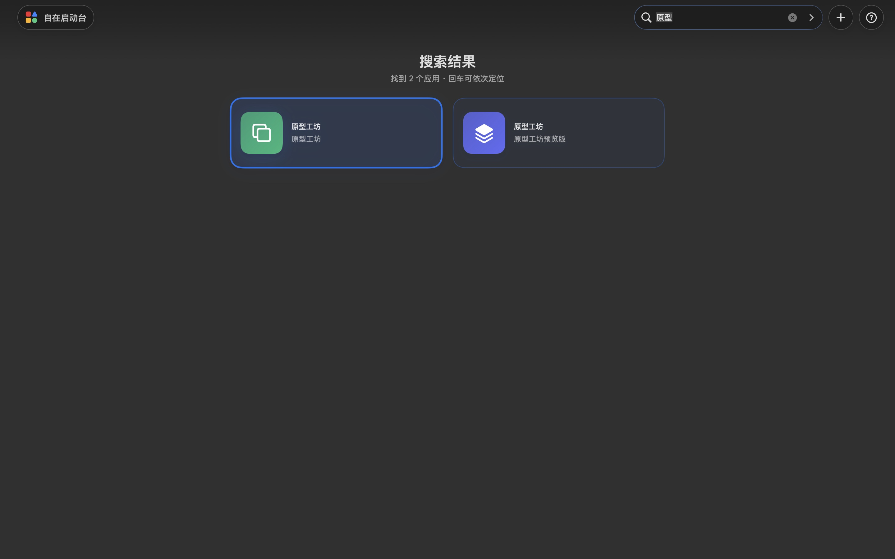

# Zizai Launchpad

[Chinese documentation](README.md)

Zizai Launchpad is a local-first macOS application organizer and launcher. It scans installed applications inside a regular sandboxed window and lets people arrange them with groups, a freeform spatial canvas, aliases, and search.

The product is currently Chinese-first. Contributions that preserve the privacy, interaction, migration, and verification contracts are welcome.



## Engineering principles

- No networking, analytics, advertising, or tracking SDKs.
- App Sandbox with read-only, user-selected application folders.
- Cancellable scanning, batched icon preparation, and serialized background persistence.
- Atomic JSON state, verified backup recovery, and schema migration.
- One `LauncherStore` state aggregate with separate catalog, placement, group, and canvas command boundaries; every undoable command commits a value-semantic state revision instead of retaining view closures.
- Standard XCTest and isolated XCUITest targets plus executable behavior, rendering, and performance audits.

## Build and test

Requirements: macOS 13 or newer and full Xcode 27.

```sh
./scripts/build.sh
xcodebuild test \
  -project "自在启动台.xcodeproj" \
  -scheme "自在启动台" \
  -destination "platform=macOS,arch=$(uname -m)"
./scripts/verify_release.sh
./scripts/run_ui_tests.sh
```

The regular `自在启动台` scheme runs the deterministic native regression suite and enforces coverage floors for critical modules. The separate `自在启动台-UI` scheme runs the end-to-end suite covering navigation and modal dismissal, multi-instance search and outside-click dismissal, real pointer group reordering, real pointer cross-group app movement, spatial app movement with undo, menu-driven cross-group moves, app visibility, canvas zoom, and persistence across relaunch. Dedicated interaction audits additionally cover drag boundary geometry, state transactions, and performance; both evidence layers must pass. The local release gate and CI execute these tests for real through `run_ui_tests.sh`; a compiled UI test bundle is never reported as an executed pass. Exact counts and results are generated from the current source and `.xcresult` bundles by the release gate instead of being copied into stable documentation.

The local build uses ad-hoc signing and is not an App Store or Developer ID release. See [RELEASE_READINESS.md](RELEASE_READINESS.md), [CONTRIBUTING.md](CONTRIBUTING.md), [ARCHITECTURE.md](ARCHITECTURE.md), and [SECURITY.md](SECURITY.md) before contributing.

Licensed under the [MIT License](LICENSE).
